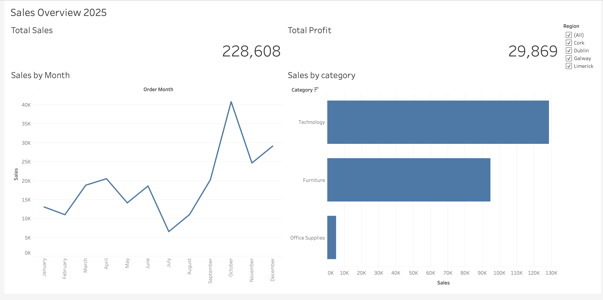

# Sales Performance Dashboard

A small practice project: an interactive dashboard that shows sales and profit by month, category and region.

**Tool:** Tableau Public (or Power BI, if you built it there)
**Data:** `data/sales_sample.csv`, 300 made-up orders from 2025. This is practice data, not real company data.

## What the dashboard shows
- Total sales and total profit (cards)
- Sales by month (line chart)
- Sales by category (bar chart)
- A Region filter (Dublin, Cork, Galway, Limerick) that updates every chart

## Screenshot

## Findings
- Technology had the highest sales, but Office Supplies had the best profit margin.
- [Add one more finding from your own dashboard.]

## What I learned
- [One or two sentences, for example: how to connect a CSV, build charts and add a filter that works across sheets.]

## Link
[Sales Performance Dashboard 2025 (Tableau Public)](https://public.tableau.com/views/SalesOverview2025/SalesOverview2025)